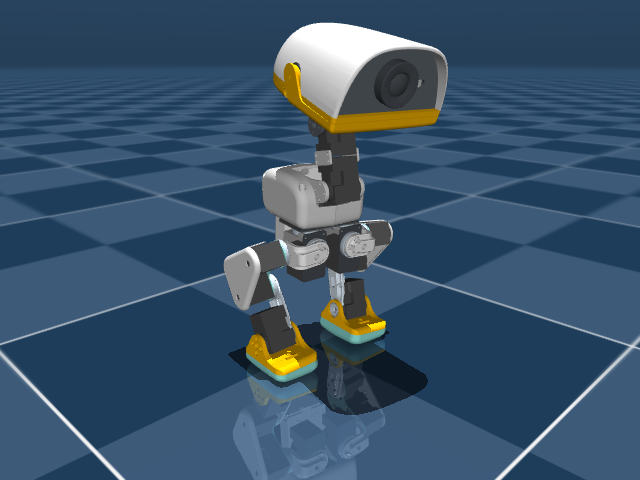

# Microduck 复刻前软件运行指南

验证日期：2026-10-09。环境：macOS / Apple Silicon / Python 3.12.13。

验收结果与已知开放项见 [software-preflight-results.json](software-preflight-results.json)。18项部署测试、4项训练测试通过；本地完整检查的逐项日志保存在 `.omx/artifacts/preflight/20261009T064501285215Z/`。

## 目前跑到了哪里

已在这台 Mac 上安装部署与训练环境，恢复真实14关节机构资源，完成原始 ONNX 推理、10秒模拟站立、15秒低速模拟演示，以及CPU的一轮PPO更新→保存新权重→导出ONNX→推理。**这些结果证明本地软件流程能够运行；实机复刻和通用行走稳定性还没有通过。**

| 验收项 | 实际结果 |
| --- | --- |
| 部署依赖、真实几何、14关节/51维策略接口 | 通过回归测试 |
| 教程默认启动和延迟下，零速度策略站立10秒 | 完成500控制周期，最低机身高度0.11070m，未低于0.10m |
| 来源参数、KP200、目标0.05m/s、渐进命令、无模拟传感延迟 | 完成750周期/15秒，前进0.4273m，横移−0.0090m，最大倾角3.92° |
| 上述低速演示的跟踪误差 | 实际身体前进速度均值0.03784m/s，约24%误差；最终偏航+5.19° |
| 教程默认延迟、KP125、渐进0.10m/s行走 | 失败：翻倒；750周期中417周期低于高度阈值 |
| MjLab训练环境CPU初始化/重置/3次物理步进 | 通过；actor[1,51]、critic[1,66]，14动作，观测/奖励有限 |
| 新14关节示例训练→保存→导出→ONNX检查/推理 | 通过：1环境、24步、1轮PPO，参数实际更新；示例明确标记不可用于实机 |
| 仓库原始 `velocity.pt` 导出为当前策略 | 不兼容：63维观测/18动作，当前任务需要51/14，已加入清楚的提前报错 |
| CUDA训练、实机舵机/IMU/供电/行走 | 未验证；本机 PyTorch 的 CUDA 不可用 |

模拟演示见 [slow-walk-demo.mp4](assets/sim-preflight/slow-walk-demo.mp4)。这是日志中真实物理状态的逐帧回放，不是预制动画；画面明确标注本地模拟。下面为默认配置站立10秒末帧：



## 本机直接运行

在仓库根目录打开终端。已安装的虚拟环境可以直接使用，不需要连接机器人。

```sh
python3 scripts/local_preflight.py --training
```

它依次运行部署回归、10秒模拟站立、训练回归和CPU短步进，退出码非零表示检查失败。每次新建 `.omx/artifacts/preflight/<时间>/`，保存测试输出、真实状态日志和 `report.json`；不会连接串口或 SSH。报告中的 PASS 只覆盖列出的软件检查。

还要复验训练与导出完整流程时：

```sh
python3 scripts/local_preflight.py --training --training-update
```

只进行1轮PPO更新，保留默认网络与PPO参数。产物在新的 `UNTRAINED_DEMO_NOT_FOR_HARDWARE` 目录，文件和元数据均有标记；不会替换原 `walk.onnx` 或 `velocity.pt`，也不会上传训练日志。1轮更新只验证通路，不能训练出可供实机使用的步态。

单独跑站立：

```sh
microduck/.venv/bin/python microduck/src/sim/sim_main.py \
  --headless --walk --ticks 500 --log logs/standing.jsonl
```

相对 `--log` 路径从 `microduck/` 目录计算，所以上例写入 `microduck/logs/standing.jsonl`；也可传入绝对路径。

复现已录制的低速演示：

```sh
microduck/.venv/bin/python microduck/src/sim/sim_main.py \
  --headless --ticks 750 --walk --policy-immediately \
  --policy-kp 200 --velocity 0.07142857142857144 0 0 \
  --command-delay 2 --command-ramp 2 \
  --initial-height 0.12 --physics-timestep 0.005 \
  --delay-act 0 --delay-vel 0 --delay-gyro 0 --delay-quat 0 \
  --log logs/demo-slow.jsonl
```

`--velocity` 接收归一化输入，前进上限为0.7m/s，因此0.07142857映射为0.05m/s。此演示站立2秒、加速2秒，使用上游机构的高度/时间步/KP200，并显式取消模拟延迟、跳过硬件启动插值。**这些是模拟对照参数，不应直接覆盖树莓派的硬件配置。**硬件默认KP125与膝关节偏移没有改。

有窗口交互查看模型（Mac须使用 `mjpython`）：

```sh
cd microduck
make sim
```

键盘 `v` 切换行走策略；零速度时是站立。交互窗口退出即可结束。有限无窗口演示更适合重复验证。

## 在另一台电脑安装

需要 `uv` 和 Python 3.12。两个目录各有保存的 `uv.lock`，按验证时的依赖版本安装：

```sh
cd microduck
uv sync --locked --group sim --python 3.12
cd ../mjlab_microduck
uv sync --locked --python 3.12
cd ..
python3 scripts/local_preflight.py --training
```

部署侧使用 BAM 1.0.2、MuJoCo 3.15.0、ONNX Runtime 1.31.0。训练侧使用 MjLab1.3.0、Warp1.12.0、Git BAM1.0.0，Git提交固定在锁文件中。这两套 BAM API 不完全一致，已分别适配；树莓派上仍须重新安装/验收，Mac通过不证明ARM Linux设备已通过。

本次安装训练 Git 依赖时曾出现网络 TLS 错误，限定此次调用使用 HTTP/1.1 后成功；没有修改全局 Git 配置。

## 修复了哪些实际阻塞

1. 原部署场景是另一个19执行器模型，缺少策略需要的踝关节等名称；训练端 `robot/`、`actuator/` 模块也缺失。恢复了 Pollen 官方14关节 walk 模型和38份真实网格，原19执行器资产保留。源提交、网格哈希、许可和本地适配见 [MODEL_SOURCE](../microduck/src/model/mjcf/microduck_14dof/MODEL_SOURCE.md)。
2. BAM给MuJoCo的是扭矩，但原XML执行器把它作为目标位置，造成额外 `−0.55*q` 力矩。现在受控执行器使用直接力矩模式，保留电流/力矩限幅；零扭矩、指定扭矩、超范围限幅都有真实物理回归。
3. 适配 BAM 初始化、浮动根DOF摩擦索引、电压跌落单位、模拟电流读回和重置；有限控制周期每次推进物理。过流保护没有取消。
4. 模型/策略路径改为从文件位置定位，可从仓库根运行；策略检查关节次序、观测/动作尺寸、默认姿势及有限数值。
5. 训练侧补齐README和BAM字段展开兼容事件，完成真实CPU环境验证；导出时明确拒绝旧18关节权重，不裁剪或伪造权重。
6. 校准UI默认安装四元数与部署常量对齐；示例用户名改为发布镜像的 `user`。实际安装方向仍须测量确认。

## 实操前我还能替你完成什么

已经完成：软件安装与锁版本、打印包清点、BOM/ID/供电检查表、模拟演示、模型来源记录、故障复现和回归。打印与装配见 [准备清单](打印与装配准备清单.md)。

接下来可以继续协助：按你的打印机或打印服务商准备切片前核对表；按实际已购硬件对照BOM查漏；制作逐关节编号/零位记录卡；准备树莓派安装与联网流程；检查SD镜像校验；硬件接入后读取舵机枚举、IMU更新率/姿态/延迟，并按单关节、悬空、支撑站立、低速行走分阶段保存证据。购物、刷卡、接线和机械测量需要你的实际设备/材料信息。

优先顺序：确认打印/机构版本 → 单独完成舵机ID和机械零位 → 确认5V/6V电源与共地 → 确认IMU方向/更新率 → 支撑站立 → 低速步态。不要只凭“程序没报错”判断实机可以行走。

两个重要版本开放项：

- 当前部署策略哈希 `5707c06da8346ecd4c2ff15dcd74ffabc575e0f14bcbb18076501324f9bbe279`，元数据训练日期2026-09-04；没有清单证明这份权重对应恢复的官方机构/电机模型的精确版本。默认延迟行走失败和更高速偏航仍须处理。
- 之前导入Fusion的 laotawayer 社区STEP/SolidWorks是另一条复刻路线；尚未证明兼容帆哥这份3MF、孔位和装配。复刻本教程应先以本仓库根 `microduck3D打印.3mf` 为依据。

## 来源与视频证据边界

用户指定的 [Bilibili视频](https://www.bilibili.com/video/BV1uUbG6FEfb/) 公开元数据显示作者“AI研究室-帆哥”、2026-09-08发布、时长21:57，简介链接 [AI-FanGe仓库](https://github.com/AI-FanGe/Microduck-build-tutorial)。用户的 [karekin分支](https://github.com/karekin/Microduck-build-tutorial) 本次克隆基线为 `49678215d0b40529522772a40c06c216390449dd`。

字幕接口未返回字幕，媒体下载受平台限制；本次没有获取可靠全文转录，不能声称逐句看完并核实所有视频步骤。本指南的硬件/软件事实来自该仓库文件、官方模型来源和实际本机执行。视频发布时使用的源码提交尚未确定。
