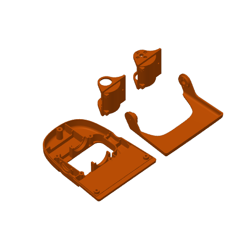
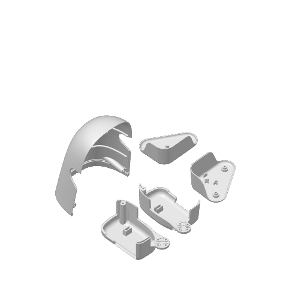
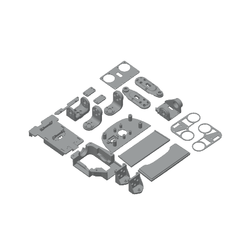
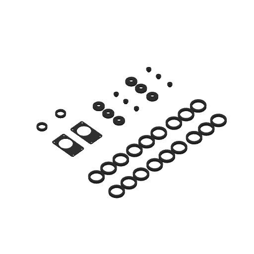
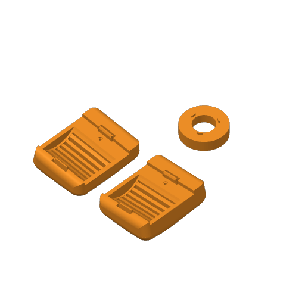

# 打印与装配准备清单

> 2026-10-09；仓库基线 `49678215d0b40529522772a40c06c216390449dd`。打印统计来自原始3MF，装配要求来自README与源码；尚未取得教程视频字幕/画面，也没有本次实机验收。

## 交给打印服务商

- 原包：根目录 [`microduck3D打印.3mf`](../microduck3D打印.3mf)，按完整Bambu工程导入。
- 明细：[`print-package-manifest.json`](print-package-manifest.json)，含分板、实例、网格引用、包围盒和原设置。
- README提到的 `microduck/cad/` 在此基线中不存在，应使用根3MF。此前另行取得的Fusion社区CAD不能证明与本教程结构、舵机、零位或行走模型兼容，不应混用。

原包大小 **5,298,732 bytes**；SHA-256：

```text
e78a329d264bc5050c00b8ff6a37d6b1195b6ea128bd9760492f31b4a91cc71e
```

原包未修改。下面缩略图是原PNG原样副本。未生成G-code、打印任务或报价。清单省略设计者账号标识、源文件绝对路径等私人元数据。

## 打印结构与数量

| 口径 | 核实结果 |
|---|---|
| 打印板 | 5 |
| 主模型资源对象 / build item | 67 / 67，build均标记printable=1 |
| model_settings配置对象 | 67，是对应对象名称/材料配置，不额外增加打印数量 |
| 5板明确分配的实例 | **65** |
| 未分板实例 | **2**：root object 55、56，原名均为`idle_horn.stl`，位于板外 |
| Object `.model`成员 | 67：36个有网格、31个406-byte空占位 |
| 空占位含义 | XML的resources与build均为空，自身没有组件引用；真正复用在主模型components中发生 |
| 网格资源 / 几何内容哈希 | 36 / 32；内容相同不等于已确认的工程零件分类 |
| 多次引用资源 | 5个，增加31个build引用；其中2个引用属于未分板实例 |
| 资源网格规模 | 219,463 vertices / 441,068 triangles，不按实例倍增 |
| 基础检查 | ZIP CRC通过；缺失几何引用0、三角索引越界0、非有限坐标0 |

这些检查只证明引用和基础数据可解析。闭合性、非流形、薄壁、切片修复、孔配合、实物强度尚未检查，不能据此判定打印质量PASS。

### 分板验收

原中文板名逐字来自`Metadata/model_settings.config`。尺寸为应用component/build变换后的包全局坐标轴对齐跨度，单位mm、显示保留0.01mm；不是装配尺寸，也不是各板原点坐标。

| 检查 | 板 | 原板名 | 分板实例 | 网格资源 | X×Y×Z mm | 材料槽索引 |
|---|---:|---|---:|---:|---|---|
| [ ] | 1 | 黄色的鸭嘴和脚部分 | 4 | 4 | 200.76 × 121.20 × 39.49 | 4 |
| [ ] | 2 | 白色的外壳 | 5 | 5 | 187.36 × 167.48 × 116.07 | 17 |
| [ ] | 3 | 灰色的结构件 | 19 | 18 | 228.84 × 233.85 × 34.50 | 1 |
| [ ] | 4 | 结构件 舵机转盘 轴承 | 34 | 6 | 213.03 × 176.66 × 4.60 | 3 |
| [ ] | 5 | 浅黄色的眼镜和脚掌 | 3 | 3 | 108.63 × 95.14 × 18.38 | 10 |

合计65个分板实例是原包数量，不保证全部都是一台机器人的必需件，也未确认备用件用途。板外object55/56均为16.00×16.00×4.15mm，需装配负责人确认是否补打；服务商不要自行移动或删除。

### 原包缩略图

**板1：黄色的鸭嘴和脚部分**



**板2：白色的外壳**



**板3：灰色的结构件**



**板4：结构件 舵机转盘 轴承**



**板5：浅黄色的眼镜和脚掌**




### 按原名核对数量

保留原文件名，不根据缩略图编造中文零件名。尺寸是该网格首个分板实例在打印摆放方向的包围盒，其他实例变换详见JSON。

| 板 | 原文件名 | 该网格分板数量 | root object ID | 首实例 X×Y×Z mm |
|---:|---|---:|---|---|
| 1 | `3.obj` | 1 | 2 | 91.76 × 117.12 × 20.06 |
| 1 | `4.obj` | 1 | 4 | 91.41 × 69.44 × 29.04 |
| 1 | `grbrgn.obj` | 1 | 64 | 36.50 × 25.50 × 39.49 |
| 1 | `thngthm.obj` | 1 | 66 | 36.50 × 25.50 × 39.49 |
| 2 | `5.obj` | 1 | 6 | 91.76 × 61.93 × 116.07 |
| 2 | `7.obj` | 1 | 8 | 41.69 × 80.89 × 33.71 |
| 2 | `8.obj` | 1 | 10 | 42.42 × 80.55 × 32.02 |
| 2 | `fgb.obj` | 1 | 72 | 61.00 × 47.66 × 28.00 |
| 2 | `gbgb.obj` | 1 | 74 | 61.00 × 47.66 × 28.00 |
| 3 | `a.obj` | 1 | 12 | 54.50 × 83.49 × 17.00 |
| 3 | `b.obj` | 2 | 14, 60 | 32.45 × 19.00 × 34.50 |
| 3 | `d.obj` | 1 | 16 | 20.00 × 11.00 × 2.00 |
| 3 | `e.obj` | 1 | 18 | 20.00 × 11.00 × 2.00 |
| 3 | `f.obj` | 1 | 20 | 58.06 × 45.00 × 1.00 |
| 3 | `g.obj` | 1 | 22 | 58.06 × 45.00 × 1.00 |
| 3 | `h.obj` | 1 | 24 | 54.20 × 73.50 × 18.80 |
| 3 | `i.obj` | 1 | 26 | 54.05 × 6.67 × 3.80 |
| 3 | `j.obj` | 1 | 28 | 35.00 × 18.00 × 27.69 |
| 3 | `k.obj` | 1 | 30 | 20.00 × 58.00 × 7.95 |
| 3 | `l.obj` | 1 | 32 | 20.00 × 58.00 × 7.95 |
| 3 | `m.obj` | 1 | 34 | 57.00 × 36.00 × 3.00 |
| 3 | `n.obj` | 1 | 36 | 23.00 × 20.50 × 25.80 |
| 3 | `o.obj` | 1 | 38 | 23.00 × 20.50 × 25.80 |
| 3 | `p.obj` | 1 | 40 | 87.82 × 33.32 × 3.01 |
| 3 | `q.obj` | 1 | 42 | 87.67 × 32.88 × 8.62 |
| 3 | `dfbdfbbbbb1.obj` | 1 | 70 | 35.90 × 34.00 × 22.50 |
| 3 | `ghmghmghmghm.obj` | 1 | 76 | 87.65 × 44.63 × 12.50 |
| 4 | `dfvdfb.obj` | 2 | 50, 51 | 23.00 × 40.00 × 3.00 |
| 4 | `ersgtbgertgestrg.obj` | 18 | 53, 87, 88, 89, 90, 91, 92, 93, 94, 95, 96, 97, 98, 99, 100, 101, 102, 103 | 22.00 × 22.00 × 4.00 |
| 4 | `idle_horn.stl` | 6 | 57, 77, 79, 81, 83, 85 | 16.00 × 16.00 × 4.15 |
| 4 | `idle_cap.stl` | 6 | 59, 78, 80, 82, 84, 86 | 6.80 × 6.80 × 4.60 |
| 4 | `rgbn.obj` | 1 | 62 | 14.60 × 14.60 × 3.00 |
| 4 | `rgbn.obj` | 1 | 68 | 14.60 × 14.60 × 3.00 |
| 5 | `111.obj` | 1 | 44 | 54.01 × 41.20 × 18.36 |
| 5 | `222.obj` | 1 | 46 | 54.03 × 41.22 × 18.38 |
| 5 | `333.obj` | 1 | 48 | 30.00 × 30.00 × 9.50 |

复用较多的资源：`object_42.model`18次、`object_109.model`6次、`object_105.model`8次（其中2次未分板）；`object_11.model`与`object_32.model`各2次。每种网格只打印一份会漏件。

## 原包切片配置

| 字段 | 原值 |
|---|---|
| 保存应用 / 日期 | BambuStudio-02.07.01.62 / 2026-09-04 |
| 打印机 / 喷嘴 | Bambu Lab P1S / 0.4mm |
| 工艺预设 | `0.20mm Standard @BBL X1C`，名称带X1C但机器字段为P1S，服务商必须复核 |
| 层高 / 首层 | 0.2 / 0.2mm |
| 打印区域 / 高度 | 256×256 / 250mm |
| 热床 | Textured PEI Plate，原温度55°C |
| 材料配置 | 21个槽均声明PLA；首槽Bambu PLA Basic，其余Generic PLA；不是21种必购材料 |
| 喷嘴温度 | 全部槽220°C，含首层 |
| 墙 / 稀疏填充 | 2圈 / 15%，grid |
| 支撑 | enable_support=1，tree(auto)，Z顶/底间距0.2mm，XY间距0.35mm |

这是原保存配置而非通用推荐。中文板颜色名、缩略图颜色、色槽配置不能直接作为最终耗材映射。服务商应按实际机器/材料逐板复核颜色、支撑和孔口。包中没有已切片G-code文件，无法据此给出可信耗材重量、工时、费用或尺寸公差。

### 服务商交付前

- [ ] 以SHA-256确认原包，保留不变副本。
- [ ] 完整工程导入后确认5板/65个分板实例，不按36网格各打印一份。
- [ ] 确认2个板外实例用途，未经装配负责人确认不移动、删除或补打。
- [ ] 更换机器时重新匹配机型/材料，复核P1S机器字段与X1C工艺预设。
- [ ] 每板检查悬空、越界、重叠、薄壁、支撑遮孔及切片修复提示，保留异常截图。
- [ ] 由装配负责人指定涉及舵机、舵盘、连接孔的试装样件，实测配合。本清单不提供公差或缩放比例。
- [ ] 按板号/root object ID分袋计数，保留重复件，不按随意中文名称混装。

## 硬件与装配准备

以下来自当前README和源码，不是本次已验证的视频步骤。

### 物料

- [ ] Raspberry Pi Zero 2 W×1，microSD≥16GB×1。
- [ ] OpenRB-150×1，USB数据线、Dynamixel三芯线/分线。
- [ ] XL330-M288-T×14：腿10、头颈4；嘴ID15可选，当前模型不依赖它。
- [ ] 成品6V电池包×1、开关×1、稳定5V Pi供电；持续/峰值电流能力需供应商确认。
- [ ] BNO080/BNO085/BNO086模块×1与I2C线。
- [ ] M2/M2.5自攻螺丝。英文README另列POM/钢垫片、JST线/电源连接器、U2D2+Power Hub；中文BOM没有全列。
- [ ] 万用表、端子/压线工具、绝缘材料；确认打印件与实际舵机配合。

### 舵机ID与机械零位

| 检查 | ID | README部位 |
|---|---:|---|
| [ ] | 1 | 右踝 |
| [ ] | 2 | 右膝 |
| [ ] | 3 | 右髋俯仰 |
| [ ] | 4 | 右髋横滚 |
| [ ] | 5 | 右髋偏航 |
| [ ] | 6 | 左踝 |
| [ ] | 7 | 左膝 |
| [ ] | 8 | 左髋俯仰 |
| [ ] | 9 | 左髋横滚 |
| [ ] | 10 | 左髋偏航 |
| [ ] | 11 | 头俯仰 |
| [ ] | 12 | 颈俯仰 |
| [ ] | 13 | 头偏航 |
| [ ] | 14 | 头横滚 |
| [ ] | 15 | 嘴，可选 |

- [ ] Wizard分别确认Protocol2.0、1Mbps、Return Delay Time0、PWM Slope255；记录ID，避免重复。
- [ ] README建议取消输入电压错误Shutdown触发项；采用前应对照实际供电与舵机保护要求，本清单未验证其硬件安全性。
- [ ] 右膝ID2偏置**+45°**、左膝ID7 **−45°**，见`microduck/src/constants.py`。先核对实际舵盘安装，不能当通用对称零位。

### 供电与IMU

- [ ] 6V电池经开关供OpenRB/舵机，Pi稳定5V；依实际模块方案共地。
- [ ] Pi通过USB数据线连接OpenRB，确认串口枚举；检查Dynamixel线序。
- [ ] 上电前检查极性、短路、焊点绝缘、连接器与电池电压；不能把6V舵机侧直接当Pi 5V输入。
- [ ] IMU按模块标识用3.3V/GND，SDA GPIO2、SCL GPIO3、I2C bus1。
- [ ] 当前部署`IMU_MOUNT_QUAT=(0.7071068,0,0.7071068,0)`，实际安装方向须匹配模型。
- [ ] 根`bno08x_calibrate_ui.py`默认`(0.5,-0.5,-0.5,0.5)`与部署不同，示例用户`pi`也与镜像`user`不同。使用工具时显式匹配用户与安装方向，先核对直立projected_gravity接近`[0,0,-1]`。

### 首次软件与受控实机顺序

1. [ ] 完成软件预检、打印件试装、ID/供电/IMU检查；Mac模拟验证不等于硬件通信通过。
2. [ ] 取得README的`image.v1/microduck.img.xz`并校验，Pi Imager自定义镜像刷目标卡，不应用额外OS customization。
3. [ ] 配置2.4GHz Wi-Fi，首次启动等待1–3分钟；SSH到`user@microduck.local`或实际IP，修改默认密码。
4. [ ] 确认虚拟环境与`src/agents/walk.onnx`存在，模型匹配机械、IMU与偏置；首次复刻不必先重训策略。
5. [ ] 在稳定位置扶住机器人运行`PYTHONPATH=src .venv/bin/python src/main.py`，核对neutral pose后才按`v`开始行走。
6. [ ] 验证`x`归零、`q`停止；必要时按README使用`src/stop.py`并确认停止。
7. [ ] 关机后等10–15秒再断电。手柄START长按2秒启动、A切换步行、B停止、双扳机长按2秒关机。
8. [ ] 手柄连接时无头服务会关Wi-Fi；需要SSH时先关手柄，等待Wi-Fi恢复。

## 仍需确认

- 视频拍摄时commit/镜像/装配角度过程、视频与当前3MF逐件一致性，尚未取得字幕/画面证据。
- 匿名原名与中文零件/装配位置的可靠对照，需要作者或装配负责人补充。
- 板外两实例用途、螺丝/垫片准确数量、电池瞬时电流、5V模块规格、机械公差、耗材/工时、色槽映射和实物行走仍待确认。

来源：原包`3D/3dmodel.model`、`3D/Objects/*.model`、`Metadata/model_settings.config`、`Metadata/project_settings.config`；当前[README](../README.md)、[部署常量](../microduck/src/constants.py)、[IMU校准UI](../bno08x_calibrate_ui.py)。后续修改结构/模型时应重新核查。
